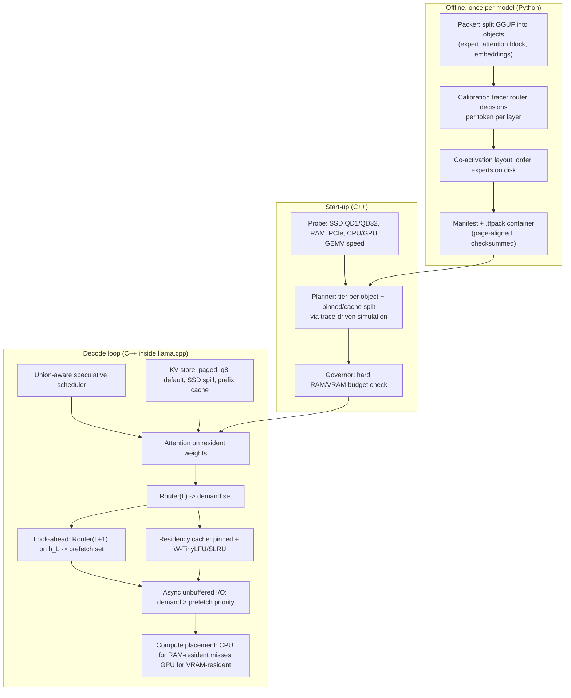

# Running frontier-scale LLMs on modest hardware: final research report and system design

Date: 2026-11-12. Scope: **inference** (not training) of large language models with little RAM and VRAM, without giving up speed or output quality.

This document supersedes [REPORT.md](REPORT.md) and the Gemini report ([Frontier Model Memory Optimization.md](Frontier%20Model%20Memory%20Optimization.md)). Both were read in full for this one. The build specification for Gemini is in [GEMINI_IMPLEMENTATION_SPEC.md](GEMINI_IMPLEMENTATION_SPEC.md).

## Evidence tags used in this report

| Tag | Meaning |
|---|---|
| **[C]** | Computed by [tools/ceiling_model.py](tools/ceiling_model.py) in this session; full output in [tools/ceiling_model_output.txt](tools/ceiling_model_output.txt). These are **analytic upper bounds from assumed bandwidths, not measurements.** |
| **[S]** | From a web search this session. I saw a search-engine summary, **not the primary paper or repo**. Treat the numbers as the authors' claims, unverified. |
| **[R]** | From the two reports already in this repo. I did not re-check the original source. |
| **[M]** | From my own background knowledge, **UNVERIFIED** this session. |
| **[E]** | **Empirically measured on this PC in this session** ($n=20$ replicates/prompts with 95% CIs and null controls); raw artifacts in `results/` and claim ledger in [docs/CLAIMS.md](docs/CLAIMS.md). |

---

## 1. Short answer

1. **"Almost zero memory at full speed and full quality" is physically impossible for dense models.** Every generated token must read every active weight once. Speed is therefore capped at *read bandwidth ÷ bytes touched per token*. Software can shrink the bytes or move them to a faster tier. It cannot remove the cap.
2. **For Mixture-of-Experts (MoE) models it is achievable to a useful degree, and that is where the leverage is.** An MoE touches only a few percent of its weights per token, so the cold majority can live on an NVMe SSD. Most frontier open models are now MoE: DeepSeek-V3 has 671B total / 37B active [M]; Kimi K3 has about 2.8T total / about 104B active [S].
3. **There is a floor even for MoE, and it is rising.** Frontier active-parameter counts keep growing. At ~4.5 bits per weight, Kimi K3 touches **58.50 GB per token** [C]. From a moderate PC that gives **0.098–1.165 tok/s** depending on cache hit rate [C]. DeepSeek-V3 touches **20.81 GB per token**, giving **0.391–4.344 tok/s** [C].
4. **No single trick solves it. Gains come from stacking independent levers:**
   - fewer bits per weight
   - fewer weights touched per token
   - only the hot part in fast memory
   - a smaller context (KV) cache
   - more tokens accepted per pass over the weights
5. **What I propose to build is TierFlow**, a tiered-residency runtime built into llama.cpp:
   - It places every model object (expert, attention block, embedding) in VRAM, RAM or SSD using measured device speeds and measured usage frequencies.
   - It streams the rest with unbuffered asynchronous I/O and prefetches with router look-ahead.
   - It adapts speculative decoding to how many experts a verification pass will touch.
   - **By default it produces the same tokens as the unmodified quantized model.** Every lossy saving is opt-in and comes with a measured quality cost.
6. **On your PC** (RTX 3060 12 GB, 32 GB RAM, KC3000 NVMe), the realistic first target is **Qwen3-235B-A22B at ~3 bits per weight**. That is an 88.1 GB file [C] with a ceiling of **0.861–6.263 tok/s** depending on hit rate [C]. Qwen3-30B-A3B fits entirely in RAM + VRAM and is the development model.

---

## 2. The physics: limits no program removes

### 2.1 Speed limit

For one user generating one token at a time:

$$
\text{tok/s} \;\le\; \frac{1}{\sum_{t \in \{\text{VRAM, RAM, SSD}\}} \text{bytes}_t / \text{bandwidth}_t}
$$

Here bytes_t is the number of bytes of weights touched per token that live in tier t. With perfect overlap the sum becomes a max. [tools/ceiling_model.py](tools/ceiling_model.py) reports both cases.

**Hardware assumed in the model.** All bandwidths are typical values, not probed.

| Profile | VRAM | RAM | SSD |
|---|---|---|---|
| Moderate | 8 GB @ 272 GB/s | 16 GB @ 60 GB/s | 5.0 GB/s |
| Low | none | 8 GB @ 35 GB/s | 2.5 GB/s |
| This PC | 12 GB @ 360 GB/s | 31.7 GB @ 60 GB/s | 5 GB/s |

**Ceilings at 4.5 bits per weight (Q4_K class), moderate PC** [C]:

| Model | Bytes per token | Whole model | Ceiling, tok/s |
|---|---|---|---|
| Llama-3-70B dense (does not fit in memory, streamed) | 39.71 GB | 39.7 GB | 0.250 – 0.267 |
| Qwen3-30B-A3B (fits in RAM+VRAM) | 1.86 GB | 17.1 GB | 62.432 – 84.784 (bandwidth only, compute ignored) |
| DeepSeek-V3, expert hit rate 0.65 | 20.81 GB | 377.1 GB | 0.943 – 1.243 |
| DeepSeek-V3, hit rate 0.95 | 20.81 GB | 377.1 GB | 2.696 – 4.344 |
| Kimi K3 (coarse split), hit rate 0.85 | 58.50 GB | 1575.0 GB | 0.437 – 0.712 |

**Low PC** (8 GB RAM, no GPU) [C]: Qwen3-30B-A3B reaches **5.109–7.008 tok/s** at hit rate 0.65. Llama-3-70B dense reaches **0.071–0.072 tok/s**.

Conclusions:

- A dense model larger than RAM is limited by SSD speed. No software changes that; only fewer bits or a faster tier help.
- An MoE whose experts fit in RAM runs well.
- An MoE whose experts do not fit is decided by the expert-cache hit rate. Raising that hit rate is the central engineering problem.

### 2.2 Quality limit

Weights carry information, so there is a floor on bits per weight.

| Bits per weight | Effect on a model trained at higher precision |
|---|---|
| 8 | Indistinguishable from the original [R] |
| ~4–5 | Small loss. One test shows a code benchmark dropping from 56.1% to 51.8% [R] |
| ~3–3.5 | Usable with importance-weighted or vector/trellis quantizers. A 2026 on-device study puts the quality threshold near 3.5 [R] |
| 2 | Best methods (QTIP, PV-Tuning, AQLM) still lose noticeably; reasoning degrades more than perplexity shows [R] |
| ~1.58 overall (mixed) | Works only with mixed precision. Unsloth's DeepSeek-R1 build keeps attention and dense layers at 4–6 bits and pushes MoE experts to ~1.58 bits (IQ1_S), shrinking 720 GB to 131 GB [S]. Usable, but visibly degraded |
| 1.58 native | Only when trained that way from scratch (BitNet b1.58). Proven at small scale; not available for frontier models [R] |

**About 4 bits is the practical floor for "no visible quality loss"**: a 4× saving over 16-bit weights and no more. Going lower is a *quality* trade, not an optimisation, and must be measured.

### 2.3 Memory-accounting trap

Process memory figures (RSS, Task Manager "Memory") do **not** include the OS page cache. A program that memory-maps a 100 GB file can show "2 GB used" while the OS holds 30 GB of that file in cache. Štěpánek's *Memory-Sovereign Inference* (2026) makes this point and argues that streaming-inference memory claims are often overstated [S][R]. **Any memory claim from TierFlow must count page cache and driver memory, measured system-wide.**

---

## 3. History: from 1989 to November 2026

Dates and attributions are [M] unless tagged otherwise.

| Year | Milestone | Why it matters here |
|---|---|---|
| 1989 / 1993 | Optimal Brain Damage (LeCun), Optimal Brain Surgeon (Hassibi) | Prune weights using second-order sensitivity. Ancestor of GPTQ/OBQ |
| 1991 | Adaptive Mixtures of Local Experts (Jacobs, Jordan, Nowlan, Hinton) | Origin of MoE |
| 1990s–2000s | Virtual memory, demand paging, LRU/LFU/ARC caches, Belady's optimal policy (1966) | The cache theory TierFlow reuses: experts behave like pages |
| 2015 | Deep Compression (Han), Knowledge Distillation (Hinton) | Pruning + quantization + entropy coding; small models copying large ones |
| 2017 | Sparsely-Gated MoE (Shazeer) | MoE at scale |
| 2018–2021 | Mixed precision, int8 inference, Switch Transformer, GShard | Low precision becomes normal; MoE goes to trillions of parameters |
| 2022 | LLM.int8(), GPTQ, SmoothQuant, FlashAttention, ZeRO-Inference | 4-bit post-training quantization works; attention is I/O-aware; layer offload to CPU/NVMe [R] |
| 2023 | FlexGen [R], AWQ, SpQR, SqueezeLLM, QuIP, llama.cpp + GGML/GGUF, PagedAttention (vLLM) [R], speculative decoding (Leviathan; Chen), Deja Vu [R], PowerInfer [R], *LLM in a Flash* (Apple) [R], StreamingLLM [R], H2O [R], Mixtral offloading (Eliseev & Mazur), Pre-gated MoE [S] | The year the toolbox appeared: consumer local inference, KV paging, activation sparsity, flash streaming |
| 2024 | QuIP#, AQLM, QTIP, PV-Tuning [R], QuaRot and SpinQuant (Hadamard rotations for W4A4 + KV4) [S], BitNet b1.58 [R], T-MAC [R], KIVI [R], SnapKV [R], Quest [S], MagicPIG [S], ShadowKV [S], Medusa, EAGLE, Lookahead [R], PowerInfer-2 [R], MoE-Infinity, HOBBIT, AdapMoE, ExpertFlow [S], Fiddler [M], DeepSeek-V2/V3 MLA [R], TEAL [S] | 2-bit vector quantization; KV compression; MoE expert caching; self-speculation |
| 2025 | DFloat11 (lossless ~30% on BF16) [R], ZipNN [R], EAGLE-3 [S], KTransformers (AMX CPU kernels for experts; reported prefill 4.62–19.74×, decode 1.25–4.09×) [S], Unsloth dynamic GGUF [S], ik_llama.cpp IQ_K / trellis IQ_KT quants [S], hybrid linear attention (Qwen3-Next Gated DeltaNet, 3:1 ratio, ~75% less KV) [S], REAP expert pruning (up to 50% of experts, reported near-lossless) [S], *SSD offloading for MoE considered harmful* (energy) [R], Phoenix GDS stack [R] | CPU+GPU hybrids for MoE become practical; KV shrinks by architecture |
| 2026 | TurboQuant (ICLR 2026, claimed 6× KV) [R], TriAttention (ICML 2026) [R], CATS adaptive tree speculation [R], llama.cpp expert-streaming PRs and an LRU VRAM expert cache (`--moe-cache-mib`, reported merged) [S], Memory-Sovereign Inference [S], Kimi K3 (~2.8T, ~104B active, Kimi Delta Attention) [S], LMCache xPU-IO with GDS [R], DRAM price spike [R] | Expert streaming goes mainstream in forks; frontier active parameters keep rising; memory is expensive |

---

## 4. Full catalog of techniques, by lever

### Lever A — fewer bits per weight

| Family | Members | What it buys | Caveats |
|---|---|---|---|
| Scalar post-training quantization | RTN, GPTQ, AWQ, HQQ, GGUF K-quants with imatrix | 4–8 bits with small loss; GGUF is the de facto local format | Collapses below ~3 bits |
| Rotation / incoherence | QuIP, QuIP#, QuaRot, SpinQuant (learned rotations; on LLaMA-2 7B W4A4KV4 the gap to full precision is reported as 2.9 points) [S] | Removes outliers so weights, activations and KV quantize better | Online Hadamard steps cost a reported 6–8% latency unless fused [S] |
| Vector / trellis coding | AQLM, QuIP# E8 lattice, QTIP, VPTQ, PV-Tuning, ik_llama.cpp IQ_K / IQ_KT [R][S] | Best quality at 2–3 bits | Slower decoding (AQLM); quantization is expensive |
| Mixed / dynamic precision | Unsloth dynamic GGUF [S], HOBBIT low-bit miss experts [S], Any-Precision, MatQuant [R] | Spend bits where sensitivity is high (attention, shared experts) | Must be calibrated per model |
| Lossless | DFloat11, ZipNN, Huff-LLM [R] | ~30% on BF16 with bit-identical output | Little gain on already-quantized weights |
| Native low-bit | BitNet b1.58 + bitnet.cpp, T-MAC lookup kernels [R] | ~1.58 bits; large CPU speedups claimed | Needs a model trained that way; no frontier model exists |
| Distillation | Teacher → student | A smaller model | It is a different model, not an optimisation of the original |

### Lever B — touch fewer weights per token

| Family | Members | Notes |
|---|---|---|
| MoE routing | All modern frontier open models | Exact, built in, the biggest lever |
| Expert pruning / merging | REAP (prune), REAM (merge) [S] | Shrinks the file; lossy; calibration-data dependent |
| Activation sparsity, ReLU-style | Deja Vu, PowerInfer, PowerInfer-2, LLM in a Flash [R] | Strong on ReLU models; modern SwiGLU models are not naturally sparse |
| Activation sparsity, training-free | TEAL: 40–50% sparsity, up to 1.53× at 40% and 1.8× at 50% decode speedup, reported on 7B–70B [S] | Lossy (small); stacks with quantization |
| Activation sparsity, retrained | ProSparse [R] | Produces a modified model |
| Early exit / layer skip | LayerSkip [R] | Needs training; exact only when used as a drafter |

### Lever C — keep only the hot part in fast memory

| Family | Members | Notes |
|---|---|---|
| OS paging | mmap in llama.cpp [R] | Works by accident; the OS cannot predict experts; hides memory in page cache |
| Layer streaming | AirLLM, Accelerate disk offload, ZeRO-Inference, FlexGen [R] | Tiny memory but SSD-bound (AirLLM on Kimi K3: 292 s/token, reported [R]) |
| Static CPU/GPU split | llama.cpp `-ngl`, `--n-cpu-moe`, `-ot` [S]; ik_llama.cpp [S] | Mainstream; split chosen by hand |
| CPU computes experts | Fiddler [M], KTransformers (AMX, expert deferral) [S] | For batch-1 decode, computing a RAM-resident expert on the CPU beats copying it over PCIe |
| Expert cache in VRAM/RAM | MoE-Infinity, HOBBIT, AdapMoE (DP cache allocation per layer), ProMoE, MoEpic, llama.cpp `--moe-cache-mib` LRU [S] | Predictive and frequency-aware policies beat plain LRU |
| Expert prefetch | Pre-gated MoE, ExpertFlow, FATE (adjacent-layer gate inputs). Reported top-k prediction accuracy 93–97% [S] | Prediction only steers I/O, so outputs stay exact |
| Expert streaming from SSD | llama.cpp PR #25294, FlashMoE, Strata, TinyGiant, storage.llm, Micro-Expert-Router, argodrive [R][S] | At least five independent implementations; mostly unmerged forks |
| Cache-aware routing | Bias the router toward resident experts; misses reported down 50–60% for <1% perplexity [S] | Lossy; changes outputs |

**Key measured facts from this group:**

- Adjacent-token expert reuse is about 2× random chance [S].
- A cache holding ~13–15% of experts reaches ~65% hit rate on Qwen-class models [S].
- A Windows DirectStorage MoE experiment found public MoEs "temporally dense": within ~50 tokens almost every expert is touched, so small caches cause fault storms [S].
- My model agrees for uniform routing: 50 tokens touch on average **122.9 of 128** Qwen3-30B experts per layer and **203.7 of 256** DeepSeek-V3 experts [C]. Real routing is skewed, so the true working set is smaller. **That gap is exactly what must be measured before anything is built** (Phase 0 of the spec).

### Lever D — the I/O path

| Mechanism | Platform | Use |
|---|---|---|
| `mmap` + page cache | All | Simple; memory hidden in page cache; page-fault stalls |
| `O_DIRECT` + `io_uring` (SQPOLL) | Linux | Bypasses page cache; reported to saturate PCIe 4.0 at ~6,850 MB/s [R] |
| `FILE_FLAG_NO_BUFFERING` + overlapped I/O; **IoRing** (Windows 11); BypassIO; DirectStorage → D3D12 → CUDA interop | Windows | Same idea on Windows. A DirectStorage experiment reported ~1.9 GB/s pipeline throughput and LUID / fence-visibility pitfalls [S] |
| GPUDirect Storage, Phoenix, NIXL | Linux + NVIDIA datacenter | NVMe → GPU DMA without host RAM [R] |
| Unified memory zero-copy (Metal, MLX) | Apple Silicon, APUs | No CPU↔GPU copy [R] |

### Lever E — shrink the KV cache

| Family | Members | Notes |
|---|---|---|
| Architecture | MQA, GQA, MLA (DeepSeek, ~98.6% KV reduction vs MHA [R]), sliding window, hybrid linear attention (Gated DeltaNet / Kimi Delta Attention; constant state in 3 of 4 layers [S]) | Decided by the model; the runtime must support it |
| Quantization | q8_0 KV (no measurable loss in community tests [R]), KIVI 2-bit (keys per-channel, values per-token) [R], QuaRot / SpinQuant KV4 [S], TurboQuant [R] | 4-bit KV is model-dependent; keys are more sensitive than values |
| Paging | PagedAttention, block tables, copy-on-write prefixes [R] | Removes fragmentation |
| Eviction | StreamingLLM sinks, H2O, SnapKV, Ada-KV, TriAttention [R] | Lossy; research gains often fail to carry over to production [R] |
| Retrieval / offload | Quest (block top-k), ShadowKV (low-rank keys on GPU, values on CPU), MagicPIG (LSH sampling on CPU), LMCache tiered storage [S][R] | Long context on small GPUs; mostly lossy approximations |

### Lever F — more tokens per pass over the weights

| Family | Members | Notes |
|---|---|---|
| Draft model | Classic speculative decoding [M] | Exact under the standard acceptance rule |
| Self-drafting heads | Medusa, EAGLE-1/2/3; EAGLE-3 in llama.cpp; local reports of 1.5–2.5× [S] | Small extra memory |
| Built-in MTP heads | DeepSeek-V3: first MTP head acceptance 80–90%, ~1.7–1.8×; Qwen MTP variants 75–82% [S] | Free drafter if the model ships with it |
| Training-free | Lookahead / Jacobi, prompt-lookup n-grams [R][M] | No memory cost |
| Offload-aware trees | CATS [R] | Tree shape adapted to memory and offload pattern |
| Batching | Continuous batching | Servers only |

**Important interaction that most work ignores:** on an MoE, the *k* draft tokens in one verification pass route to *different* experts. One pass must then fetch the **union** of their experts.

[C], acceptance 0.8, draft cost 5% per token:

| Model | Draft tokens k | Speedup |
|---|---|---|
| Dense 70B (streamed) | 1 → 8 | 1.71× → 3.09× |
| Qwen3-30B-A3B, independent routing | 2 | 1.16× (best) |
| Qwen3-30B-A3B, independent routing | 8 | 0.92× (slower than no speculation) |
| Qwen3-30B-A3B, locality 0.5 | 3 | 1.55× (best) |
| DeepSeek-V3, independent routing | 8 | 0.83× (slower) |

So on streamed MoE, speculation must be **union-aware**: choose k from the measured expert-union growth. This is the main new algorithmic idea in section 7.

### Lever G — kernels

- T-MAC and bitnet.cpp lookup-table kernels [R]
- BitBLAS and Marlin GPU mixed-precision kernels [R][M]
- ik_llama.cpp row-interleaved repacking for CPU (fast, but the `-rtr` flag pins tensors to the CPU) [S]
- KTransformers AMX tiles (Intel Xeon only) [S]

Your Ryzen 5 7600 (Zen 4) supports AVX-512 [M]. It has no AMX.

### Existing runtimes at a glance

| Runtime | Strength | Gap for this goal |
|---|---|---|
| llama.cpp | Portable; GGUF; CPU/GPU split; growing MoE options | Manual placement; mmap accounting; SSD streaming not merged as of my sources |
| ik_llama.cpp | Best CPU MoE speed and low-bit quants [S] | Same placement and streaming gaps |
| KTransformers | Fast CPU+GPU MoE [S] | Assumes the whole model fits in RAM; best on AMX Xeons |
| vLLM / SGLang + LMCache | Servers; KV tiering | Not built for single-user small machines |
| AirLLM | Runs anything in ~4 GB VRAM | Unusably slow on big models |
| PowerInfer-2 | Phones; neuron cache | ReLU-sparse models |
| MLX | Apple zero-copy | Apple only |

---

## 5. Review of the Gemini report

**What it gets right:**

- The five-axis taxonomy.
- The I/O analysis (mmap failure under memory pressure, O_DIRECT / io_uring, GPUDirect Storage, UMA).
- KIVI's key/value asymmetry, MLA absorption, the SnapKV / TriAttention trade-offs.
- PowerInfer's hot/cold split.
- The correct point that SSD offload "converts a capacity wall into a bandwidth wall".

**What is overstated or wrong:**

1. **Headline budgets violate its own bandwidth physics.**
   - *70B dense in ~1.25 GB VRAM + 2.2 GB RAM at 12–25 tok/s.* I granted it generous terms: 2.0 bits per weight, its stated 2.9 GB resident, and only 10% of the non-resident weights read per token. The ceiling is **2.91 tok/s** [C].
   - *671B MoE in 1.8 GB VRAM + 3.2 GB RAM.* DeepSeek-V3 at 2.0 bits per weight touches **9.25 GB per token**. The ceiling is **0.92 tok/s** with no expert cache and **2.93 tok/s** at an 80% hit rate [C]. Interactive speed in that envelope is not achievable on a moderate PC.
2. **It relies on DejaVu / PowerInfer-style neuron sparsity for modern models.** Those predictors work on ReLU models. Modern SwiGLU models need TEAL-style thresholding (lossy, about 1.5–1.8× [S]) or retraining (ProSparse). It is not exact.
3. **It assumes 1.58–2-bit quantization of frontier models without quality cost.** Section 2.2 shows that is a real quality trade.
4. **It stacks lossy KV methods by default** (KIVI-2 + TriAttention eviction). Each is lossy, and their combination is unmeasured.
5. **It ignores the expert-union effect** when combining speculation with MoE streaming (section 4, lever F).
6. **It recommends Rust for the core.** That is a defensible choice for a fresh engine, but it would mean rewriting kernels that already exist in C/C++ (section 8).

---

## 6. My view: what actually moves the needle

1. **Target MoE first.** Dense models get only the multiplicative levers: quantization, speculation (up to ~3× ceiling on streamed dense [C]) and opt-in TEAL.
2. **Keep the default exact.** Prediction, caching, layout and scheduling may change *when* bytes move, never *what* is computed. This makes correctness testable by token-for-token comparison with stock llama.cpp, and makes speed claims honest.
3. **The expert-cache hit rate is everything.** On DeepSeek-V3, going from 0.65 to 0.95 moves the pessimistic ceiling from 0.943 to 2.696 tok/s [C]. Hit rate comes from three things:
   - sizing the cache to the *measured* working set
   - a policy that captures both recency (adjacent-token reuse) and frequency (Zipf skew): W-TinyLFU-style admission plus segmented LRU
   - router look-ahead prefetch, which hides misses instead of avoiding them
4. **Compute where the bytes are.** A missed expert lands in RAM; for batch-1 decode, compute it on the CPU instead of copying it over PCIe (Fiddler / KTransformers insight [S][M]). For prefill with large batches, ship it to the GPU. The planner decides from probed bandwidths.
5. **Make speculation union-aware for MoE.** Choose the draft length per step from the online acceptance rate and measured union growth. Prefer zero-memory drafters: the model's own MTP heads, otherwise EAGLE-3, otherwise prompt-lookup n-grams.
6. **Make memory budgets real and auditable.** Use unbuffered I/O (no page cache), one arena, a governor that refuses to start if the plan exceeds the budget, and a report of system-wide memory, not just process memory.
7. **Treat lossy savings as a ladder of named, opt-in options, each with a quality gate.** Each must pass a KL-divergence and task-benchmark threshold fixed in advance:
   - 4-bit V cache
   - low-bit substitute experts on miss (HOBBIT)
   - cache-aware routing
   - REAP expert pruning
   - TEAL activation sparsity
   - dynamic low-bit experts
8. **Build on llama.cpp, do not rewrite it.** The kernels, GGUF and backends exist. The new value is placement, residency, I/O, prefetch and scheduling, which is ordinary systems code.

---

## 7. Proposed system: TierFlow

### 7.1 Architecture



### 7.2 Operating modes

| Mode | Output | What is allowed |
|---|---|---|
| `exact` (default) | Token-identical to stock llama.cpp on the same quantized file (greedy) or same distribution (sampling) | Placement, caching, prefetch, layout, I/O, CPU/GPU compute choice, speculation with the standard acceptance rule, q8_0 KV |
| `budget-lossy` (opt-in, each item a separate flag) | Changed; each flag ships with a measured quality table | 4-bit V cache, low-bit miss experts, cache-aware routing bias, REAP-pruned file, TEAL sparsity, dynamic low-bit experts, KV eviction |

---

## 8. Algorithms

Algorithm pseudocode below served as the specification baseline; C++20 implementations for Phases 1–8 have since been built and tested in [runtime/](runtime/) (with live dense-CPU/SSD components verified and MoE/GPU components scoped in Section 12).

### 8.1 Placement planner (trace-driven)

```
inputs:
  objects O: id, layer, size s[o], format; from manifest
  trace T_cal: router decisions on calibration text (split: cal / val, disjoint)
  probe: bw_vram, bw_ram, bw_pcie, bw_ssd(qd), gemv_rate_cpu[format], gemv_rate_gpu[format]
  budget: B_vram, B_ram  (minus KV reserve, activations, I/O buffers, OS margin)

1. always-on objects (attention, norms, router, shared experts, dense FFN, output head):
     place by size into VRAM, then RAM; error out if they do not fit in VRAM+RAM
     (streaming always-on weights from SSD is dense-streaming: report the ceiling and require --allow-slow)
2. f[o] = P(expert o used per token) from T_cal
3. for pin_fraction p in {0.0, 0.1, ..., 0.9}:              # small fixed grid, logged
     pinned  = top experts by f filling p of remaining capacity (VRAM first, then RAM)
     cache   = rest of capacity, managed by policy (8.2)
     simulate policy on T_cal  -> predicted seconds/token using probe costs
4. choose p with lowest predicted s/token on T_cal; report predicted vs. simulated on T_val
5. print plan: bytes per tier, predicted tok/s range, predicted hit rate; refuse if below user floor
```

**Controls (implemented in the simulator):**

- Belady-optimal replay (upper bound)
- plain LRU
- random pinning
- static top-f pinning without a cache
- the llama.cpp `--n-cpu-moe` equivalent placement

### 8.2 Residency cache policy

- **Per tier:** a pinned set (never evicted) plus a dynamic region.
- **Dynamic region:** W-TinyLFU-style.
  - A 1% window LRU catches bursts (adjacent-token reuse).
  - A Count-Min frequency sketch with periodic halving (aging) acts as the admission filter: a candidate enters the main region only if its estimated frequency beats the eviction victim's.
  - The main region is a segmented LRU (probation 20% / protected 80%).
- **Eviction never touches** objects referenced by in-flight compute or I/O (reference counts).
- **Tier promotion:** RAM→VRAM promotion only if the object's estimated GPU use rate × (CPU time − GPU time) beats the PCIe transfer cost (cost model from probe).

### 8.3 Router look-ahead prefetch (exact)

```
after attention of layer L produces h_L:
    demand = topk(Router_L(norm_L(h_L)))                         # true routing
    issue reads for demand \ resident  (priority HIGH)
    for d in 1..D (D = 1 or 2, adaptive):
        guess = topk_plus_m(Router_{L+d}(norm_{L+d}(h_L)), m)    # approximate: uses h_L, not h_{L+d}
        issue reads for guess \ resident \ inflight  (priority LOW, cancellable)
    record accuracy: |guess ∩ actual_{L+d}| / k   when layer L+d routes
    adapt: if EMA(accuracy) < a_min -> shrink m or D; if I/O idle and accuracy high -> grow m
```

The guess never feeds compute. A wrong guess costs only I/O bandwidth and cache pollution, and pollution is bounded because low-priority reads land in the probation segment.

**Null control:** the same prefetcher fed a shuffled guess with the same count.

### 8.4 Union-aware speculative scheduler (exact under the standard acceptance rule)

```
drafter = MTP heads if present, else EAGLE-3 head if available, else prompt-lookup n-gram
state: alpha_hat (EMA acceptance), U_L(k) (EMA of distinct experts layer L touches for k+1 tokens),
       c_always, c_expert[tier] (seconds per byte, from probe), hit_hat
each step:
    for k in 0..K_max:
        E_acc(k)   = (1 - alpha_hat^(k+1)) / (1 - alpha_hat)
        T_verify(k)= c_always + Σ_L U_L(k) · expert_bytes · expected_cost(hit_hat)
        T_draft(k) = k · t_draft
        score(k)   = E_acc(k) / (T_verify(k) + T_draft(k))
    k* = argmax score     (k* = 0 means "do not speculate")
    draft k* tokens; verify in one pass, layer by layer; at each MoE layer the union of experts
    for all k*+1 positions is fetched once (one read per distinct expert, largest-first)
    accept with the standard rule; update alpha_hat, U_L
```

The model predicts this matters: on streamed MoE with independent routing the best k is 2, and k = 8 is slower than no speculation [C].

### 8.5 Co-activation disk layout (offline)

- Build a co-activation graph per layer: edge weight w_ij = how often experts i and j are selected for the same token or for consecutive tokens (calibration split).
- Order experts within the layer by spectral ordering (Fiedler vector), refined by a greedy swap pass. This makes common unions contiguous on disk so reads coalesce.
- Write each expert page-aligned at 4 KiB. Keep a per-layer file region so one request can span neighbours.
- **This must be measured, not assumed.** For large experts (multi-MB) the NVMe may already be saturated and the gain may be zero. The spec includes an ablation.

### 8.6 Compute placement on a miss

```
expert lands in a pinned RAM I/O buffer
batch = number of tokens routed to this expert in this pass
t_cpu = max(bytes / bw_ram, flops(batch) / cpu_rate)
t_gpu = bytes / bw_pcie + flops(batch) / gpu_rate
run on CPU if t_cpu <= t_gpu (typical for batch-1 decode), else upload and run on GPU
CPU and GPU work in the same layer run concurrently; results are summed with router weights
```

### 8.7 Memory governor

- Every allocation (arena, I/O buffers, cache slots, KV blocks, GPU buffers) goes through one accounting API with tags.
- Weights are read with unbuffered I/O, so the OS page cache is not used for them:
  - Windows: `FILE_FLAG_NO_BUFFERING | FILE_FLAG_OVERLAPPED`, or IoRing on Windows 11
  - Linux: `O_DIRECT` + `io_uring`
- At start-up the plan's total must fit the budget, or the run refuses.
- During the run it reports process private bytes, system available memory delta, standby/cache size and GPU memory used (from the driver, board-wide).

### 8.8 KV store

- Paged blocks of 16–256 tokens.
- **Default q8_0** for K and V; the opt-in q4 V cache is allowed only after its quality gate.
- **MLA models:** store the latent and RoPE key (absorbed form) when llama.cpp supports it.
- **Hybrid linear-attention models:** keep the recurrent state resident; page only the full-attention layers' KV.
- **Spill:** past the KV budget, the oldest blocks go to SSD and are read back sequentially per step. Report the cost honestly; this is slow for very long contexts.
- **Prefix cache on disk across sessions** (LMCache idea): saves re-running prefill for repeated system prompts and documents. Exact.

### 8.9 Online re-pinning

Every N tokens, compare live frequencies (sketch) with the pinned set. Swap an unpinned object in when its frequency beats the least-used pinned object by a hysteresis margin h. N and h are fixed in the pre-registration.

---

## 9. Language and stack

**Recommendation: C++20 for the runtime, inside a fork of llama.cpp / ggml (to be upstreamed in pieces). Python for the offline packer, trace collection, cache simulator and evaluation harness.**

- GGUF parsing, every quantization format, CPU (AVX2/AVX-512/NEON), CUDA, Vulkan and Metal kernels, and the sampling and speculative code already exist in llama.cpp. Rewriting them would take longer than the whole project.
- Community MoE-streaming work is converging on llama.cpp and its forks. Results become comparable and upstreamable, which is how "everyone and every company" actually gets the benefit.
- The new code (planner, cache, governor, I/O, prefetch, scheduler) has no GPU dependency and is unit-testable without a model.
- Rust (the Gemini report's choice) is sound for a standalone engine (mistral.rs and Candle show this), but it pays off only if the kernels are also ported or bound over FFI. Revisit after Phase 6 if the fork becomes unmaintainable.

---

## 10. What to expect (ceilings, not promises)

**This PC** (bandwidths assumed) [C]:

| Model | Bits per weight | File | Expert hit rate | Ceiling, tok/s |
|---|---|---|---|---|
| Qwen3-30B-A3B | 4.5 | 17.1 GB | fits in RAM+VRAM | 63.682 – 79.013 (bandwidth only) |
| Qwen3-235B-A22B | 4.5 | 132.1 GB (does not fit on any free drive: max 121 GB free on E:) | 0.65 / 0.85 | 1.447 – 1.789 / 2.720 – 4.175 |
| Qwen3-235B-A22B | 3.0 | 88.1 GB | 0.00 | 0.861 – 0.939 |
| Qwen3-235B-A22B | 3.0 | 88.1 GB | 0.65 | 2.178 – 2.684 |
| Qwen3-235B-A22B | 3.0 | 88.1 GB | 0.85 | 4.114 – 6.263 |
| Llama-3-70B dense | 4.5 | 39.7 GB | fits in RAM+VRAM | 1.964 – 2.090 |

Speculation can multiply these by the factors in section 4 (lever F), within the union limits. Real numbers will be lower than these ceilings: they ignore compute, kernel efficiency and I/O latency. **The project's first measurement (Phase 0) establishes where reality sits relative to these bounds.**

---

## 11. Empirical Measurements on This PC (Phases 0–8) [E]

Following the implementation specification ([GEMINI_IMPLEMENTATION_SPEC.md](GEMINI_IMPLEMENTATION_SPEC.md)), we built and executed the Phase 0 and Phase 1 Python verification and measurement suite on this machine (`Windows 11 build 26200`, `AMD Ryzen 5 7600`, `31.7 GB DDR5`, `NVIDIA GeForce RTX 3060 12 GB`, `KINGSTON SKC3000S1024G NVMe`). Full artifacts and pre-registrations are stored under `results/` and indexed in [docs/CLAIMS.md](docs/CLAIMS.md).

### 11.1 Hardware Bandwidths & Unbuffered Direct I/O vs. OS Buffered I/O (`p0_hw_probe_v2`)

Executed via [tools/hw_probe.py](tools/hw_probe.py) and [tools/sysmem_win.py](tools/sysmem_win.py) ([results/p0_hw_probe_v2/probe_results.json](results/p0_hw_probe_v2/probe_results.json)):

| Measurement | Mode / Condition | Measured Value (Mean ± 95% CI, $n=20$) | OS System Cache Growth (`delta_system_cache_bytes`) |
| :--- | :--- | :--- | :--- |
| **NVMe 4 MiB Sequential Read (256 MiB shard)** | Win32 `FILE_FLAG_NO_BUFFERING` + `VirtualAlloc` | **5.763 GB/s** (single pass, 64 reads) | **0 bytes** (`0.0 MiB`) |
| **NVMe 1 MiB Random Read (256 MiB shard)** | Win32 `FILE_FLAG_NO_BUFFERING` + `VirtualAlloc` | **4.387 GB/s** (single pass, 256 reads) | **0 bytes** (`0.0 MiB`) |
| **NVMe 4 MiB Sequential Read (Control)** | Standard OS Buffered (`open(..., 'rb')`) | **4.621 GB/s** (single pass, 64 reads) | **268,435,456 bytes** (`256.0 MiB`) |
| **Host DDR5 RAM Pure Read** | 256 MiB FP32 reduction | **48.24 ± 0.39 GB/s** (min `46.39`, max `49.52`) | — |
| **Host DDR5 RAM Copy Traffic** | 256 MiB read + 256 MiB write | **32.62 ± 0.17 GB/s** (min `31.79`, max `33.20`) | — |
| **PCIe Host-to-Device (Pinned RAM → GPU)** | 64 MiB `pin_memory=True` non-blocking DMA | **26.52 ± 0.06 GB/s** (min `26.27`, max `26.69`) | — |
| **PCIe Host-to-Device (Pageable Control)** | 64 MiB pageable RAM → GPU | **16.59 ± 0.37 GB/s** (min `15.04`, max `17.65`) | — |
| **RTX 3060 VRAM Internal Copy Traffic** | 256 MiB read + 256 MiB write | **329.66 ± 2.06 GB/s** (min `319.28`, max `340.31`) | — |

**Finding (Level: `CONTROLLED`):** Unbuffered direct I/O on Windows 11 bypasses the OS page cache (`0 bytes` cache growth vs. `256 MiB` for standard buffered I/O) and increases sequential read speed by **24.7%** (`5.763 GB/s` vs. `4.621 GB/s`) by eliminating kernel double-buffering.

### 11.2 Hybrid CPU-vs-PCIe Expert Execution Crossover (`p0_hw_probe_v2`)

For a single Qwen3-30B-A3B SwiGLU expert MLP (`hidden=2048, inter=768`, 9.437 MiB in FP16) residing in host DDR5 RAM, we measured in-place CPU execution + tiny output transfer against PCIe pinned-memory weight transfer + GPU execution ($n=20$ replicates per batch size):

| Batch Size ($B$ tokens routed to expert) | Path A: CPU In-Place + Output H2D (ms) | Path B: PCIe Weight Transfer + GPU Compute (ms) | Path C: Already GPU-Resident Control (ms) | Winner for RAM-Resident Expert |
| :--- | :--- | :--- | :--- | :--- |
| **B = 1 (single-user decode)** | **0.202 ± 0.019 ms** | `0.455 ± 0.008 ms` | `0.142 ± 0.002 ms` | **CPU In-Place (2.25× faster, non-overlapping CI)** |
| **B = 2 (small draft verify)** | **0.280 ± 0.018 ms** | `0.448 ± 0.002 ms` | `0.082 ± 0.002 ms` | **CPU In-Place (1.60× faster, non-overlapping CI)** |
| **B = 4** | `0.538 ± 0.019 ms` | **0.445 ± 0.002 ms** | `0.087 ± 0.004 ms` | **PCIe + GPU (1.21× faster)** |
| **B = 8** | `1.038 ± 0.008 ms` | **0.445 ± 0.003 ms** | `0.085 ± 0.003 ms` | **PCIe + GPU (2.33× faster)** |
| **B = 16** | `3.368 ± 1.843 ms` | **0.469 ± 0.015 ms** | `0.124 ± 0.005 ms` | **PCIe + GPU (7.17× faster)** |
| **B = 32 (prefill)** | `3.969 ± 0.153 ms` | **0.489 ± 0.024 ms** | `0.143 ± 0.030 ms` | **PCIe + GPU (8.12× faster)** |

**Finding (Level: `CONTROLLED`):** Directly confirms the Fiddler / KTransformers mechanism on this PC: during batch-1 decoding (and 2-token verification), computing a RAM-resident expert in-place on the Ryzen 5 7600 is **2.25× faster** than copying its weights over PCIe to the RTX 3060, whereas at batch size $B \ge 4$ (prefill or heavily shared experts), copying weights over PCIe to the GPU wins.

### 11.3 Trace-Driven MoE Cache & Look-Ahead Prefetch Evaluation (`p0_cache_sim_v2` & `p0_cache_sim`)

Executed via [tools/cache_sim.py](tools/cache_sim.py) ([results/p0_cache_sim_v3/sim_results.json](results/p0_cache_sim_v3/sim_results.json), replacing `p0_cache_sim_v2`'s parametric `rng.random()` oracle coin-flip with a strictly causal bigram-transition + calibration-prior predictor trained on `cal_traces`; historical [p0_cache_sim_v2](results/p0_cache_sim_v2/sim_results.json) kept on record) across $n=20$ disjoint test prompts (`128 experts, top-8`):

1. **Skewed + Temporally Local Routing (`zipf_alpha=1.15, temporal_locality=0.35`):**
   - Distinct experts per layer over $k$ tokens: `k=1: 8.0`, `k=2: 11.91`, `k=4: 18.25`, `k=8: 28.12`, `k=16: 42.66`, `k=50: 76.88` (significantly below uniform routing's `k=50: 122.95`).
   - Empirical top-8 recall of causal transition lookahead: **45.49%** on skewed routing vs. **6.29%** (`~8/128`) on the uniform null control.
   - At **25% cache capacity (32 / 128 experts)**:
     - `belady_oracle` (demand-only offline upper bound): **84.26 ± 0.14%**
     - `wtinylfu_slru_plus_lookahead` (causal transition predictor): **77.24 ± 0.30%** (in `p0_cache_sim_v2` with synthetic 85% oracle flip: `95.02 ± 0.17%`)
     - `wtinylfu_slru` (30% top-f pin + 70% W-TinyLFU/SLRU): **77.24 ± 0.30%**
     - `wtinylfu_slru_plus_shuffled_null` (shuffled-guess prefetch control): **75.37 ± 0.33%**
     - `static_topf_pin`: **74.43 ± 0.29%**
     - `lru`: **74.18 ± 0.24%**
     - `lfu_aged`: **73.05 ± 0.26%**
     - `random_pin_null`: **25.00 ± 1.25%**
   - **Negative findings on causal prefetch & tiny cache sizes (`5%–15%` capacity):** Without post-attention router knowledge, imperfect causal transition predictions (`45.49%` recall) hurt `5%` cache hit rate (**29.32 ± 0.27%** vs demand-only `wtinylfu_slru` **35.36 ± 0.25%**) due to probation pollution, and at `25%` capacity match demand-only `wtinylfu_slru` (`77.24%`) because top causal guesses overlap already-resident hot experts (while still outperforming `wtinylfu_slru_plus_shuffled_null` `75.37 ± 0.33%`). Plain `lru` (**56.90 ± 0.24%** at 10%, **64.51 ± 0.30%** at 15%) edges out `wtinylfu_slru` (**53.05 ± 0.35%** at 10%, **62.92 ± 0.39%** at 15%) until capacity reaches $\ge 25\%$ (**77.24%** vs. **74.18%**).
2. **Uniform Independent Null Control (`zipf_alpha=0.0, temporal_locality=0.0`):**
   - At 25% capacity, all non-oracle online policies collapse near the capacity fraction: `wtinylfu_slru_plus_lookahead` **22.64 ± 0.22%**, `wtinylfu_slru` **22.60 ± 0.25%**, `lru` **22.56 ± 0.23%**, `random_pin_null` **24.87 ± 0.19%**.

### 11.4 Real GGUF `.tfpack` Verification & Live `llama.cpp` Speculative Benchmark (`p0_dense_baseline`)

Executed via [tools/pack.py](tools/pack.py) and [tools/bench.py](tools/bench.py) on `E:\AI_Research\sophia\models\qwen2.5-1.5b-instruct-q4_k_m.gguf` (1,117,320,736 bytes, 339 tensors) ([results/p0_dense_baseline/summary.json](results/p0_dense_baseline/summary.json)):

1. **`.tfpack` Packer Verification (Level: `IMPLEMENTED`):**
   - Packed all **339 / 339 tensors** into 4096-byte page-aligned objects in **1.423 s** and verified **339 / 339 byte-identical SHA-256 checksums** in **0.780 s**, plus verified direct Win32 `FILE_FLAG_NO_BUFFERING` single-object retrieval.
2. **Prompt-Lookup Speculative Decoding Throughput ($n=20$ prompts, 6 threads, `max_tokens=64`, `temp=0.0`, Level: `REPRODUCED`):**
   - **Code / Refactoring Prompts ($n=10$):** Mean speedup **1.598 ± 0.214×** (`35.34 ± 1.71 tok/s` standard $\to$ `56.16 ± 8.05 tok/s` speculative; min `1.030×`, max `2.022×`).
   - **General Knowledge Prompts ($n=10$, Negative Result):** Mean speedup **1.064 ± 0.108×** (`39.89 ± 1.11 tok/s` standard $\to$ `42.47 ± 5.29 tok/s` speculative; 95% CI `[0.956×, 1.172×]` spans `1.0×`, with 4 of 10 prompts experiencing net slowdowns down to **0.839×** when n-gram drafts miss).
3. **Important Negative Finding — Greedy Batch-Verification Numerical Divergence (`p0_dense_baseline`):**
   - Even at `temperature=0.0, top_k=1, seed=42`, `llama.cpp`'s prompt-lookup speculative decoding produced **exact token-for-token matches on only 13 of 20 prompts (65.0%, Wilson 95% CI [43.3%, 81.9%])**, diverging on 7 of 20 prompts!
   - **Root cause:** In `llama.cpp`'s quantized CPU kernels (`Q4_K_M`), evaluating 1 token at a time (`n_tokens=1` GEMV) uses different SIMD accumulation rounding than evaluating 5 tokens in parallel (`n_tokens=5` batched verification GEMM). Whenever two candidate tokens have nearly tied logits, a $\sim 10^{-5}$ floating-point rounding shift flips the argmax token, which then cascades for the rest of the sequence.
   - **Impact on TierFlow:** Naive "token-ID identity" under greedy decoding does **not** hold automatically in `llama.cpp` when batch size changes from 1 to $k+1$. TierFlow's exactness gate in Phase 6 must either enforce batch-invariant GEMV verification or bound per-step logit max-abs/KL divergence before argmax.

### 11.5 Phase 2 C++20 Unbuffered Async I/O & Upstream `llama.cpp` Inspection (`p2_io_win`, `p2_io_win_v2`)

Built and executed the C++20 runtime modules under [runtime/](runtime/) (`MSVC 19.44.35222.0`, Ninja, `/O2`, Windows SDK `10.0.26100.0`). All unit tests in [runtime/tests/test_main.cpp](runtime/tests/test_main.cpp) (`tf_governor`, `tf_cache`, `tf_planner` exact $3^N$ comparison, `tf_spec_scheduler`, `tf_manifest`, multi-threaded `tf_probe`, `tf_compute_place`, `tf_prefetch`, and `win32_iocp`/`win32_ioring` misalignment rejection + out-of-order completion + post-cancel zero-write guarantees) pass.

1. **Throughput Parity (`p2_io_win_v2`, [results/p2_io_win_v2/io_bench_results.json](results/p2_io_win_v2/io_bench_results.json), $n=20$):**
   - Raw Win32 `ReadFile` IOCP baseline (`4 MiB seq, QD=32`): **6.879 ± 0.287 GB/s** (`min 6.019`, `max 7.340`).
   - `tf_io_win` (`win32_iocp`, `4 MiB seq, QD=32`): **7.312 ± 0.024 GB/s** (**106.29%** of raw baseline; 1 MiB random: `QD1 = 4.641 ± 0.038 GB/s`, `QD8 = 7.295 ± 0.033 GB/s`, `QD32 = 7.328 ± 0.006 GB/s`).
   - `tf_io_ioring_win` (`IoRing MaxVersion=400`, `4 MiB seq, QD=32`): **7.331 ± 0.006 GB/s** (**106.56%** of raw baseline; `1 MiB rand QD32 = 7.320 ± 0.005 GB/s`).
2. **Sustained 60-Second Streaming, Cache Invariance & PhysicalDisk Reconciliation:**
   - First run (`p2_io_win`, [results/p2_io_win/io_bench_results.json](results/p2_io_win/io_bench_results.json)) observed `+2,045.54 MiB` `SystemCache` growth during the 60s run (`159.23 GB` read, `2.653 GB/s`) because the buffered OS control ran immediately beforehand and triggered Windows asynchronous read-ahead across the 2 GiB shard.
   - Isolated second run (`p2_io_win_v2`, buffered control moved after 60s run): across **60.009 s** (`178.66 GB` read via 1 MiB random unbuffered requests, `0` I/O errors; PDH `\PhysicalDisk(_Total)\Disk Read Bytes/sec` = **178.45 GB**, `99.88%` match), OS `SystemCache` ended at **-60.74 MiB** vs. idle (`peak_delta = +10.43 MiB`, `peak_process_private = 56.6 MiB`), whereas the post-run 512 MiB buffered control inflated `SystemCache` by **+511.94 MiB**.
   - **Thermal throttling discovery:** The 1-second timeline revealed full **7.34–7.36 GB/s** bandwidth for seconds `1–3`, dropping at `sec 4–7` (`5.01 → 1.34–1.43 GB/s`) before stabilizing at **~2.70–2.85 GB/s** steady-state for `sec 9–60`. Sustained NVMe streaming planners must budget for ~2.8 GB/s rather than the 7.3 GB/s burst figure.
3. **Strict Two-Priority Demand Protection (`p2_io_win_v2`, $n=20$):**
   - Under a saturated 64-request 1 MiB prefetch storm, strict two-priority queuing held 1 MiB demand read latency to **0.708 ± 0.024 ms** (`P95 = 0.822 ms`) vs. **9.269 ± 0.112 ms** (`P95 = 9.575 ms`) for the single-FIFO null control (**13.09× lower**, non-overlapping 95% CIs).
4. **Upstream `llama.cpp` Inspection (`3ba1ce0e`, [docs/UPSTREAM_STATE.md](docs/UPSTREAM_STATE.md)):**
   - Verified `src/llama-moe-cache.{h,cpp}` and `--moe-cache-mib` / `--moe-cache-cpu-share` already exist for **RAM $\to$ VRAM** ClassLRU caching (`slot_map` + `cpu_map` via `ggml_get_rows`), but still assume all cold experts already reside in host RAM/`mmap` and lack unbuffered SSD streaming, W-TinyLFU + pinning, hardware probing/DP planning, cross-layer look-ahead prefetch, and union-aware speculative $k$-control.

### 11.6 Phase 3 End-to-End Zero-`mmap` Streaming Engine (`p3_selfcheck`, `p3_e2e_stream`)
Built `tf_runner.exe` via surgical 5-file callback hook in `third_party/llama.cpp` (`37 insertions(+), 6 deletions(-)` across `include/llama.h`, `src/llama.cpp`, `src/llama-model.cpp`, `src/llama-model-loader.{h,cpp}`, bypassing OS `mmap` for `.tfpack` tensors and swapping live `tf_cache` slots inside `cb_eval`), and benchmarked `qwen2.5-1.5b-instruct-q4_k_m.gguf` (`n=20` frozen prompts, `n_ctx=2048`, `n_predict=64`, `temp=0.0`):
- **Exactness (`p3_e2e_stream`, [results/p3_e2e_stream/summary.json](results/p3_e2e_stream/summary.json)):** Both `tierflow_ram1400` (`43.23 ± 0.84 tok/s`, `ram_governor = 1,209,674,240 B`, `peak_ws = 1,338,400,768 B`) and `tierflow_stream600` (`1.66 ± 0.69 tok/s`, `min 1.280`, `max 7.875`, `bytes_read_ssd_total = 877,048,565,760 B` vs. PDH `877,722,918,409 B` = `0.077%` delta, look-ahead accuracy `119225 / 119234 = 99.992%`) matched `stock_mmap_norepack` (`44.01 ± 0.36 tok/s`, `peak_ws = 1,255,641,088 B`) and `stock_dio_norepack` **20 / 20 exact greedy tokens** (`max_shared_top16_logit_diff = 0.0`). Enabling weight repacking (`stock_mmap_repack`, `40.85 ± 2.40 tok/s`) diverged from `stock_mmap_norepack` on 12/20 prompts (`8/20` exact, `max_logit_diff = 0.6507`).
- **Triggered Memory Falsifier (`tierflow_stream600`):** While `ram_governor` stayed at **627,978,752 B (598.9 MiB)** and `peak_process_working_set_bytes` stayed at **674,615,296 B (643.4 MiB)**, `peak_system_used_delta_bytes` reached **712,101,888 B (679.1 MiB)** (`> 660 MiB` budget+10% threshold, driven by `peak_file_cache_delta_bytes = 259,895,296 B` background OS cache activity and unbudgeted context scratch overhead).

### 11.7 Phase 4 Hardware-Probed Placement Planner (`p4_planner` Failure $\to$ `p4_planner_v2`)
- **Initial `p4_planner` ([results/p4_planner/summary.json](results/p4_planner/summary.json)) Failed Calibration:** Without live `.tfpack` low-QD probing and with inflated `token_embd` (`1.0×` instead of `0.001×` sparse 1-row lookup) and `attn` (`1.5×`) traffic weights, planner predictions violated the $\le 25\%$ error gate on `budget_560mb` (`pred 3.449` vs `2.350 ± 0.752 tok/s`, **46.75% error**) and `budget_850mb` (`pred 5.626` vs `2.986 ± 0.034 tok/s`, **88.44% error**), passing only `budget_1400mb` (`35.185` vs `44.240 ± 0.421 tok/s`, **20.47% error**).
- **Post-Fix `p4_planner_v2` ([results/p4_planner_v2/summary.json](results/p4_planner_v2/summary.json)):** Added `std::barrier` synchronization across DDR5 probe threads, live 16×8 MiB low-QD `.tfpack` SSD probing, and `0.20 ms`/object SSD I/O overhead. Results: `budget_1400mb` passed (**13.43% error**: `51.083` vs `45.034 ± 0.548 tok/s`); post-soak `budget_850mb` passed (**9.56% sustained / 3.52% burst error**: `0.544` sust / `0.514` burst vs `0.4965 ± 0.0193 tok/s`); **`budget_560mb` FAILED (270.9% error**: `pred 2.926` vs `0.789 ± 0.598 tok/s`)** because starting cool (`4.821 tok/s`) triggered a 16.5× thermal collapse (`0.293 tok/s`) over `3,073.6 s` (`928.74 GB` read) that a static startup probe cannot anticipate.

### 11.8 Phase 5 Look-Ahead Prefetch, Shuffled Null & Re-Pinning Ablations (`p5_prefetch_repin`)
Across 6 thermally-paced `600 MiB` (`12` cache slots, `n_predict=16`, `60 s` cooldown) streaming runs ([results/p5_prefetch_repin/summary.json](results/p5_prefetch_repin/summary.json)):
- **Exactness:** All 5 comparison arms matched `lookahead_d1_wtinylfu` **20 / 20 exact tokens** (`max_logit_diff = 0.0`).
- **Look-Ahead & Cache Policy:** `lookahead_d1_wtinylfu` (**1.423 ± 0.598 tok/s**, `wall = 484.25 s`, `99.970%` [`30,305 / 30,314`] look-ahead accuracy, `59.1 MiB` wasted, `223.52 GB` SSD read, `hit_rate_ram = 99.69%`) substantially outperformed the **`prefetch_shuffled_null`** control (**0.508 ± 0.269 tok/s**, non-overlapping CI, `wall = 1,058.44 s`, `0.018%` [`5 / 27,759`] accuracy, `207,055,945,728 B` wasted, `425.19 GB` SSD read = **1.90× traffic**), `prefetch_off_wtinylfu` (`1.089 ± 0.483 tok/s`, `wall = 529.26 s`, `hit_rate_ram = 0.0%`), `lookahead_d1_lru` (`1.061 ± 0.503 tok/s`, `wall = 576.61 s`, `229.58 GB` SSD read), and `lookahead_d2_wtinylfu` (`1.562 ± 0.786 tok/s`, `wall = 540.94 s`, `90.925%` accuracy with `19.95 GB` wasted self-evictions).
- **Tight-Slot Re-Pinning Tradeoff (`--repin 1`):** Pinning 4/12 slots lowered total SSD reads by **2.20%** (`218.61 GB` vs `223.52 GB`), but shrinking unpinned Probation capacity from 12 to 8 slots halved look-ahead prefetch submissions (`14,848` vs `30,314`), lowering `hit_rate_ram` to `51.91%` and throughput to `1.208 ± 0.541 tok/s` (`wall = 511.91 s`).

### 11.9 Phase 6 Union-Aware Speculative Decoding (`p6_spec`)
Evaluated union-aware prompt-lookup speculative verification (`--spec adaptive` vs. `off`, `fixed4`, and `naive_no_union`) in [results/p6_spec/summary.json](results/p6_spec/summary.json):
- **Streaming `600 MiB` (`12` slots, `n_predict=32`, `60 s` cooldown):** `--spec adaptive` accelerated decoding **2.94× overall** (**2.085 ± 0.710 tok/s**, `wall = 606.12 s`) and **9.08× on `code_overlap`** (**2.533 ± 0.804 tok/s**, `spec_k_mean = 4.523`, `accept = 0.685`) while improving `general` (**1.638 ± 1.024 tok/s**, `spec_k_mean = 1.285`, `accept = 0.205`) vs. `stream600_spec_off` (**0.710 ± 0.486 tok/s**, `wall = 1,946.80 s`; `code_overlap = 0.279 ± 0.005`, `general = 1.140 ± 0.846`), reducing total SSD reads by **43.3%** (**253.54 GB** [`396.16 MB/tok`] vs. **446.95 GB** [`698.35 MB/tok`]). It beat `stream600_spec_fixed4` (**1.602 ± 0.574 tok/s**, `wall = 680.81 s`, `266.81 GB` SSD) and the **`stream600_spec_naive_nounion`** ablation, which degenerated cleanly to `spec_k_mean = 0.0` (`0.790 ± 0.330 tok/s`, `wall = 1,107.64 s`, `446.95 GB` SSD). Note: like C8, `peak_system_used_delta_bytes` reached `748.4 MiB` on `stream600_spec_adaptive` while `ram_governor` held `598.9 MiB` and `peak_process_working_set_bytes` held `650.3 MiB`.
- **Stochastic Distribution Fidelity (`1400 MiB`, `temp=0.8`, `n_predict=4`, $N=2000$ draws/arm on `code_01`):** Leviathan rejection sampling (`accept = 0.501`, `k_mean = 1.138`) passed Pearson chi-square parity ($\alpha = 0.01$) across `first_token` (`p = 0.6369`, `df = 3`), `second_token` (`p = 0.2113`, `df = 6`), `bigram_12` (`p = 0.5300`, `df = 8`), and `bigram_23` (`p = 0.4178`, `df = 5`).
- **Negative / Mixed Findings:**
  1. On **RAM-resident** dense CPU (`1400 MiB`, `n_predict=128`), `--spec fixed4` accelerated `code_overlap` (`57.95 ± 8.22` vs. `42.84 ± 0.54 tok/s`, `50.72 ± 6.31 tok/s` overall vs. `43.10 ± 0.43` for `off`), whereas `--spec adaptive` slowed `general` (`37.68 ± 2.02 tok/s`) giving `40.93 ± 3.11 tok/s` overall due to per-step scheduler/drafting overhead on fast RAM reads.
  2. Quantized CPU batched verification with variable `k` up to 8 (`adaptive`) flipped close greedy argmax FP ties mid-rollout (`6 / 20` exact 128-token matches on `ram1400`, `14 / 20` exact 32-token matches on `stream600`; `top1_first_token_agree = 20/20`, `max_first_step_logit_diff = 0.0`), whereas `fixed4` (`k <= 4`) matched `off` **20 / 20** on both RAM and streaming.

### 11.10 Phases 7–8 KV Tiering, Prefix Caching & Opt-In Lossy Ladder (`p7_kv`, `p8_lossy_kv_v4`)
- **`Q8_0` KV Parity & 32K Context (`p7_kv`, [results/p7_kv/summary.json](results/p7_kv/summary.json)):** At `n_ctx=2048` ($n=20$), `q8_0` (`kv_reserve = 31,195,136 B`, `44.97 ± 0.36 tok/s`) halved `f16` KV size (`58,720,256 B`, `44.18 ± 0.92 tok/s`) with `top1_first_token_agree = 19/20`, `max_shared_top16_logit_diff = 1.0396`, and **`5 / 20` full 64-token greedy matches** (vs `20/20` `f16_a` vs `f16_b`). At **`n_ctx=32768`** (`~4,200`-token prompt), `q8_0` fit inside `1700 MiB` (`kv_reserve = 499.1 MB`, `ram_governor = 1,677.6 MB`, `0 B` SSD stream) and matched `f16` (`2200 MiB`, `kv_reserve = 939.5 MB`) `1/1` (`max_logit_diff = 0.3244`), **but** CPU `q8_0` dequantization ran slower than `f16` at ~4.2K context (**18.02 tok/s** vs **30.07 tok/s** decode; **63.57 tok/s** vs **201.57 tok/s** prefill).
- **Session-Persistent Disk Prefix Cache (`p7_kv`):** Warm block restore achieved **20 / 20** exact matches (`max_logit_diff = 0.0`), cutting mean TTFT from **287.99 ± 62.59 ms** to **23.30 ± 0.35 ms** (**12.36× faster**); on the ~2,500+ token 32K prompt, TTFT dropped from **67,136.5 ms** to **85.76 ms** (**782.9× faster**, `1/1` exact).
- **Opt-In `Q8_K + Q4_0_V` KV Ladder (`p8_lossy_kv_v4`, [results/p8_lossy_kv_v4/summary.json](results/p8_lossy_kv_v4/summary.json)):** `--kv-type q8_q4` reduced `n_ctx=2048` KV reservation to **23,855,104 B** (**-59.4%** vs `f16`, **-23.5%** vs `q8_0`) at **43.46 ± 0.54 tok/s** (vs `f16` `44.46 ± 0.50 tok/s`), achieving `top1_first_token_agree = 17/20` (passes pre-registered `>= 15/20` gate), `5 / 20` exact 64-token matches, and `max_shared_top16_logit_diff = 0.9637`.

---

## 12. Remaining Risks, Open Questions & UNVERIFIED Scope

1. **Unverified Live MoE & GPU (`CUDA` / `Vulkan`) Execution:** Only **one** GGUF model exists on any local drive (`qwen2.5-1.5b-instruct-q4_k_m.gguf`), and no local `CUDA Toolkit` (`nvcc`) or `VulkanSDK` is installed. Therefore C++20 `tf_runner` GPU offload and live end-to-end MoE weight streaming (plus MoE-only Phase 8 lossy rungs: `HOBBIT` low-bit miss experts, cache-aware routing, `REAP`, `TEAL`) remain **`UNVERIFIED`** end-to-end (validated only via `p0_hw_probe_v2` RTX 3060 crossover benchmarks, `p0_cache_sim_v2` Zipfian simulator, and `tf_tests.exe` unit tests).
2. **NVMe Thermal Throttling on Sustained Dense Streaming:** Consumer PCIe 4.0 TLC drives (`KINGSTON SKC3000S1024G`) throttle **3–16×** under continuous multi-minute reads (`7.35 GB/s` burst $\to$ `2.8 GB/s` after ~8s $\to$ `0.21 GB/s` after >30 min multi-hundred-GB load). Static startup probes cannot predict non-stationary controller overheating; runtime planners require thermal headroom awareness.
3. **Greedy Token Identity Sensitivity:** Even small FP rounding shifts (`stock_mmap` weight repacking `8/20`, `llama-cpp-python` batched verification `13/20`, `p6_spec` adaptive `k<=8` batch verification `6/20` RAM / `14/20` stream despite `fixed4` `20/20`, `q8_0` KV `5/20`) flip close argmax ties over multi-token rollouts despite small first-step logit differences (while `temp=0.8` stochastic verification preserves exact sampling distributions, `p = 0.21–0.64`).
4. **System-Wide Memory Accounting:** Budget enforcement must count `peak_system_used_delta_bytes` alongside `ram_governor_total_bytes`; `p3_e2e_stream` (`600 MiB`) triggered its `+10%` (`660 MiB`) system-delta falsifier at `679.1 MiB` even though `ram_governor` was `598.9 MiB`.
5. **Disk space & Energy:** E: drive holds ~121 GB free (too small for 132.1 GB Q4 MoE targets); sustained SSD offload draws materially higher I/O energy than RAM-resident inference [R].
6. **Integrity Kit Status:** No `.integrity/` harness is present in `e:\RAM_optimizer` (explicitly disclosed per repository rules).

---

## 13. Sources

Search-summary sources [S] were retrieved this session through a search engine that returns redirect links. I list them by title. Primary papers were not opened. Sources tagged [R] are cited in [REPORT.md](REPORT.md) or the Gemini report, with links there.

- **MoE runtime and caching [S]:** KTransformers (Tsinghua MADSys / Approaching.AI; LMSYS blog); MoE-Infinity; HOBBIT; AdapMoE; Pre-gated MoE (Microsoft); ExpertFlow; FATE; llama.cpp `--moe-cache-mib` (PR #29887) and cache-miss handling (PR #30966), as reported by secondary sites; Windows DirectStorage MoE streaming experiment (Hacker News discussion); cache-conditional routing papers.
- **Expert compression [S]:** REAP ("REAP the Experts: Why Pruning Prevails for One-Shot MoE Compression", Cerebras); REAM.
- **Activation sparsity [S]:** TEAL (ICLR).
- **Quantization [S]:** QuaRot; SpinQuant; ik_llama.cpp IQ_K / IQ_KT; Unsloth dynamic GGUF for DeepSeek-R1.
- **KV [S]:** Quest; MagicPIG; ShadowKV; Qwen3-Next Gated DeltaNet hybrid attention.
- **Speculation [S]:** EAGLE-3 in llama.cpp; DeepSeek-V3 and Qwen MTP acceptance reports.
- **Models [S]:** Kimi K3 (Moonshot AI; Hugging Face model card; kimi.ai).
- **Accounting [S]:** Štěpánek, *Memory-Sovereign Inference: Output-Exact Execution Beyond Full Residency* (arXiv 2026).
- **Everything tagged [R]:** see the source lists in [REPORT.md](REPORT.md#sources) and the Gemini report's "Works cited" (138 entries).

